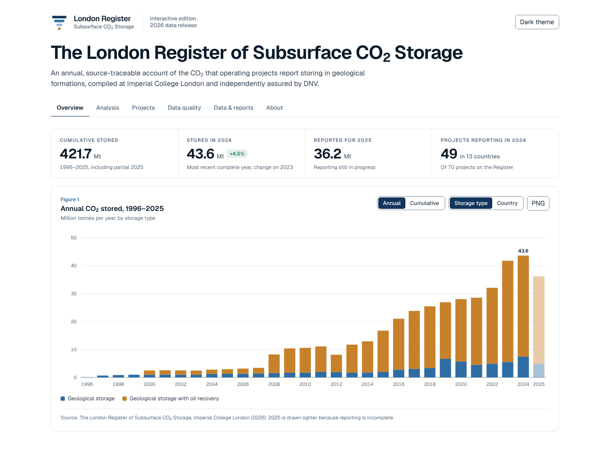
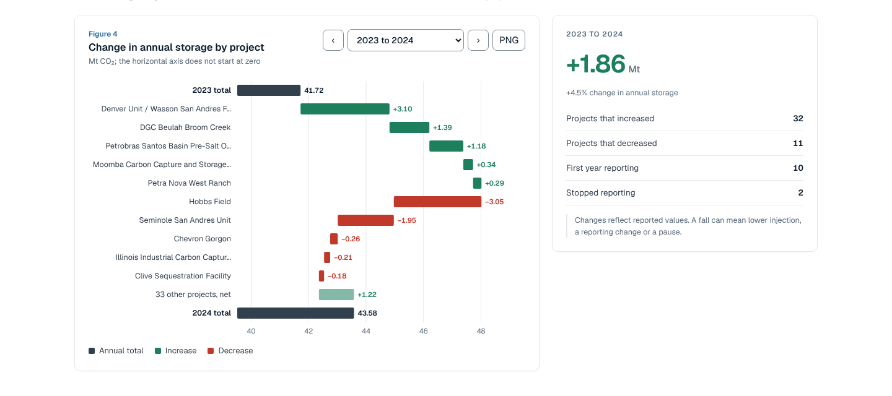
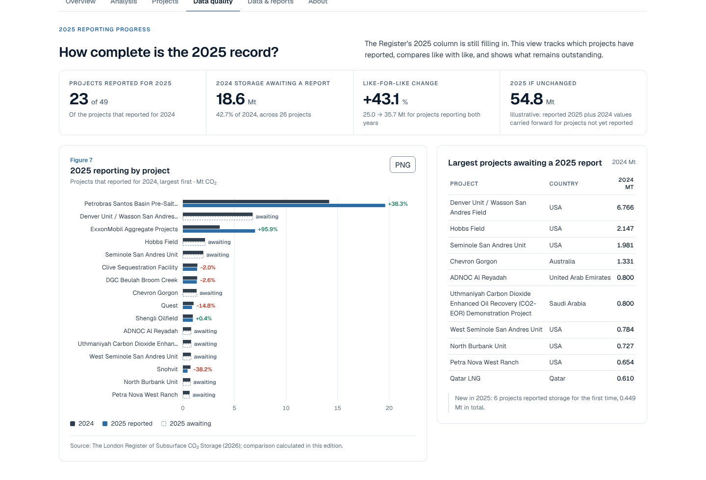
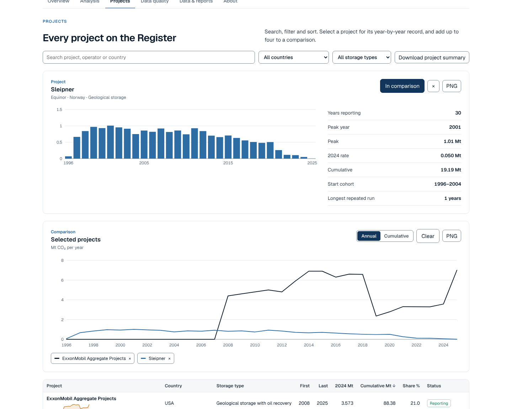
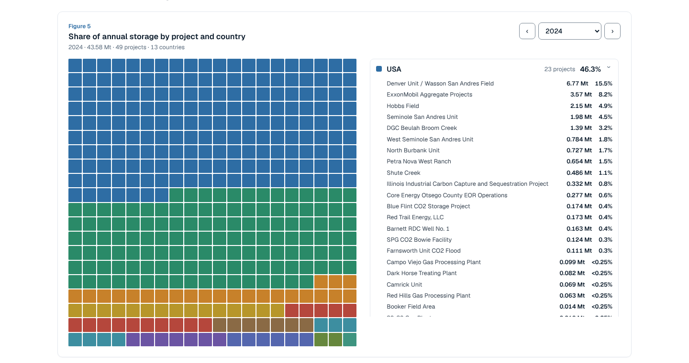
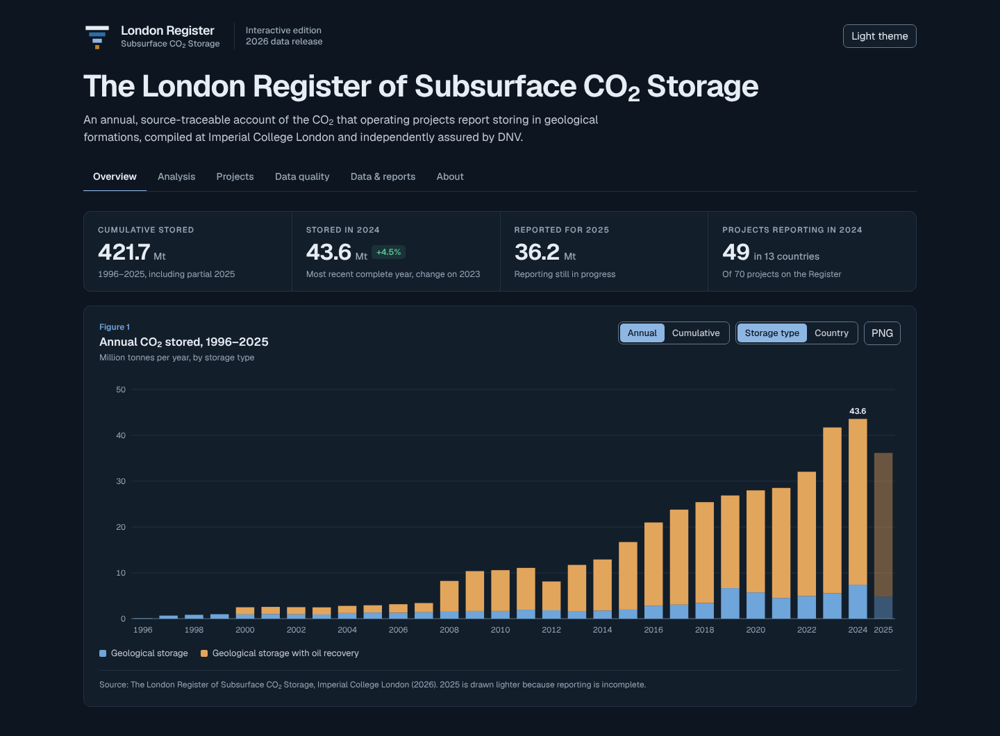
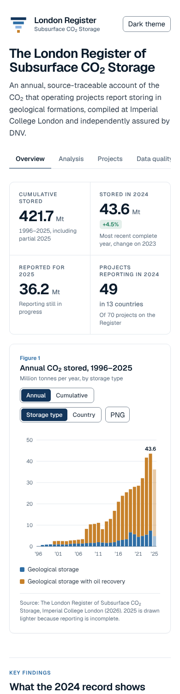

<p align="center">
  
</p>

<h1 align="center">London Register of Subsurface CO₂ Storage · Interactive Edition</h1>

<p align="center">
  An offline, single-file data explorer for every tonne of CO₂ that projects worldwide report storing underground, 1996–2025.<br>
  Built on the published data of <a href="https://imperialcollegelondon.github.io/The-London-Register-of-Subsurface-CO2-Storage/">The London Register of Subsurface CO₂ Storage</a> (Imperial College London).
</p>

<p align="center">
  <a href="https://matinshahin.github.io/london-register-interactive/"><b>Open the live site →</b></a>
</p>

<p align="center">
  
  
  
  
  
</p>

<p align="center">
  
</p>

---

## Contents

- [What this is](#what-this-is)
- [The record at a glance](#the-record-at-a-glance)
- [What is inside](#what-is-inside)
- [What this edition adds](#what-this-edition-adds)
- [Quick start](#quick-start)
- [Publish with GitHub Pages](#publish-with-github-pages)
- [Build from source](#build-from-source)
- [Project structure](#project-structure)
- [Data and methods](#data-and-methods)
- [Design system](#design-system)
- [Accessibility and quality checks](#accessibility-and-quality-checks)
- [Updating for a new edition](#updating-for-a-new-edition)
- [Licence and attribution](#licence-and-attribution)
- [Author](#author)

---

## What this is

The London Register of Subsurface CO₂ Storage is an annual, source-traceable account of the CO₂ that operating projects report injecting into geological formations. It is compiled at Imperial College London, funded by the Royal Academy of Engineering and independently assured by DNV.

This repository is an **interactive edition** of the Register's published 2026 data. It turns the annual table into an explorer that operators, investors, researchers and policy makers can read at a glance and interrogate in depth. The whole application is **one self-contained `index.html`**: fonts, chart library, world map, data and images are embedded, so it opens offline by double-clicking and can be hosted anywhere as a static file.

> This is an independent edition. It is not an official Imperial College London website. The Register's own site and annual reports remain the authoritative source for the data and its findings.

## The record at a glance

Figures computed in the page from the Register's 2026 edition:

| Measure | Value |
|---|---|
| Cumulative CO₂ stored, 1996–2025 | **421.7 Mt** (2025 reporting incomplete) |
| Stored in 2024, the latest complete year | **43.6 Mt**, up 4.5% on 2023 |
| Reported so far for 2025 | **36.2 Mt** |
| Projects on the Register | **70** in 17 countries |
| Projects reporting storage in 2024 | **49** in 13 countries |
| Growth in annual storage, 2014–2024 | **12.9% a year** (compound) |
| Share of 2024 storage injected with oil recovery | **83%** |

## What is inside

Six tabs, each built from numbered, sourced figures.

| Tab | What you can do |
|---|---|
| **Overview** | Headline figures; Figure 1 annual or cumulative storage by storage type or country; four key findings for 2024 with small trend charts. |
| **Analysis** | World map and country ranking; composition over time by country, storage type or start cohort, in Mt or share; a year-on-year bridge showing which projects moved the total for any pair of years; a 400-square grid of each year's storage by project; a fitted growth trend with an adjustable scenario to 2050. |
| **Projects** | Search, filter and sort all 70 projects with sparklines; open any project for its full history; compare up to four side by side, annually or cumulatively. |
| **Data quality** | 2025 reporting progress with a like-for-like comparison and the largest projects still to report; a coverage chart of every project's reporting history that highlights runs of identical annual values. |
| **Data & reports** | The 2026 and 2025 annual, assurance and methodology reports; definitions and calculation notes; Table 1, the full Register shaded by amount and filterable by country. |
| **About** | The Register team, citation with copyable BibTeX, further reading, and credits. |

Everywhere: tooltips on every chart, light and dark themes, a layout that works on phones, **download any figure as a PNG** with its title, legend and source, and **download the data as CSV**. Each tab has its own link (for example `index.html#quality`).

<table>
  <tr>
    <td width="50%"></td>
    <td width="50%"></td>
  </tr>
  <tr>
    <td align="center"><sub>Figure 4 · Which projects moved the total</sub></td>
    <td align="center"><sub>2025 reporting progress</sub></td>
  </tr>
  <tr>
    <td width="50%"></td>
    <td width="50%"></td>
  </tr>
  <tr>
    <td align="center"><sub>Project history and comparison</sub></td>
    <td align="center"><sub>Figure 5 · Share of each year by project</sub></td>
  </tr>
  <tr>
    <td width="50%"></td>
    <td width="50%" align="center"></td>
  </tr>
  <tr>
    <td align="center"><sub>Dark theme</sub></td>
    <td align="center"><sub>Phone layout</sub></td>
  </tr>
</table>

## What this edition adds

The official website and annual reports already provide the data, the narrative findings, the share-by-project chart, a project-level Figure 1 and a timeline of reporting standards. This edition adds interactive views of the same published data:

- **Year-on-year bridge** showing project by project how the global total changed, for any pair of years.
- **2025 like-for-like comparison** for projects that reported in both years, plus a list of the largest projects still to report.
- **Reporting coverage chart** showing every project's history and highlighting repeated annual values.
- **Start-cohort breakdown** of annual storage by when projects began reporting.
- **Project histories** for all 70 projects, with side-by-side comparison of up to four.
- **Country map** with each country's split by storage type.
- **Adjustable growth scenario** to 2050, clearly labelled as illustrative.
- **Light and dark themes** on a documented design system, PNG and CSV export, and a single file that works offline.

## Quick start

No installation, server or internet connection is needed.

1. Download or clone this repository.
2. Open `index.html` in any modern browser (Chrome, Edge, Firefox or Safari).

```bash
git clone https://github.com/MatinShahin/london-register-interactive.git
cd london-register-interactive
open index.html        # macOS  ·  use start index.html on Windows, xdg-open on Linux
```

## Publish with GitHub Pages

1. In the repository on GitHub, open **Settings → Pages**.
2. Under **Build and deployment**, set **Source** to *Deploy from a branch*, choose `main` and `/ (root)`, and save.
3. After a minute the site is live at `https://matinshahin.github.io/london-register-interactive/`.

The repository includes an empty `.nojekyll` file so GitHub serves the page exactly as built.

## Build from source

`index.html` is generated from the files in `src/` and `data/` by a short Python script with no third-party dependencies.

```bash
python3 build.py
# Wrote index.html (673 KB)
```

Edit any file in `src/` or `data/`, run the build, and open the new `index.html`. Python 3.8 or later is enough.

## Project structure

```
london-register-interactive/
├── index.html                 Built application: the only file a visitor needs
├── build.py                   Assembles index.html from src/ and data/
├── data/
│   ├── london_register_2026.csv   Annual Mt stored per project, 1996–2025 (Register 2026 edition)
│   └── register_reports.json      Links and sizes of the published reports
├── src/
│   ├── page.html              Page markup: masthead, tabs and every figure frame
│   ├── brand.css              Design-system tokens and components (fonts embedded at build)
│   ├── calcs.js               Every derived number: totals, shares, cohorts, growth fit, completeness
│   ├── app.js                 Charts and interactions for Overview, Analysis, Projects, Data and About
│   ├── quality.js             The Data quality tab
│   ├── shim.js                Small runtime that serves the embedded data to the page
│   ├── standalone.js          Theme switch and PNG/CSV downloads
│   ├── fonts/                 Geist and Geist Mono (SIL Open Font License)
│   ├── img/                   Portrait and report cover thumbnails
│   └── vendor/                d3 v7.9.0 and world-atlas 110m countries (ISC)
├── assets/logo/               Register mark for light and dark backgrounds (SVG)
└── docs/screenshots/          Images used in this README
```

## Data and methods

**Source.** Annual reported mass of CO₂ stored per project, in million tonnes (Mt), from The London Register of Subsurface CO₂ Storage, 2026 edition. The full database, with sources and quantification protocols for every value, is published on [Zenodo](https://zenodo.org/records/23400216).

**Storage types.** *Geological storage* is CO₂ injected into saline formations or depleted fields with the primary purpose of storing it. *Geological storage with oil recovery* is CO₂ injected into producing oil fields, where it improves recovery and a share is retained underground.

**Calculations in this edition** (all in `src/calcs.js`, visible and reproducible):

| Output | Method |
|---|---|
| Totals and shares | Sums of the published project values; years with no value count as zero. |
| Ten-year growth | Compound annual growth of the global total from 2014 to 2024. |
| Start cohort | Projects grouped by the first year they report storage above zero: 1996–2004, 2005–2014, 2015–2019, 2020 onwards. |
| Year-on-year bridge | Difference in each project's value between two consecutive years; the largest rises and falls are shown, the rest netted. |
| 2025 completeness | Projects that reported for 2024 are split by whether they have reported for 2025; the like-for-like change compares only projects that reported both years. |
| 2025 if unchanged | Reported 2025 total plus the 2024 values of projects not yet reported. Illustrative only. |
| Repeated values | Runs of four or more identical consecutive annual values. The Register notes that where a project reports only a cumulative amount, the average is used for each year, and its spreadsheet marks those cases. |
| Growth fit and scenario | Least-squares line through the natural log of annual totals, 2005–2024; the scenario compounds the 2024 total at a chosen rate. Illustrative, not a finding of the Register. |

**Caveats.** 2025 reporting was incomplete when the 2026 edition was compiled, so 2025 is drawn lighter throughout. Calculated outputs are labelled as calculated in this edition wherever they appear.

## Design system

The interface follows one documented design system, so every figure, control and page reads as part of the same publication.

- **Colour.** A cool-grey report page with one institutional navy (`#12355b`). Data colours carry meaning: blue `#2e6da4` for geological storage, amber `#c7812a` for storage with oil recovery, green and red for change. Blue against amber keeps the two storage types distinct for colour-blind readers. Every text colour meets WCAG AA contrast (4.5:1) in both themes.
- **Type.** Geist at five weights with tabular figures for all numbers; Geist Mono only for the citation block.
- **Figures.** Every chart sits in a numbered frame with a title, units, legend and source line.
- **Mark.** The *Ledger*: four rows narrowing downward, read as the entries of a register and as CO₂ moving into depth, ending in an amber square for what is stored. Files are in `assets/logo/`.

## Accessibility and quality checks

Before release, the built `index.html` was opened in a headless browser and checked on every tab in light and dark themes at desktop and phone widths:

- no script errors and no horizontal page scroll at any width;
- every control exercised: figure toggles and tooltips, year steppers (including 1996 and 2025), the scenario slider, country selection, project search, sort, detail and comparison, the coverage filter, the Table 1 country filter, and links that open a specific tab;
- CSV and PNG downloads produce valid files;
- headline numbers match the Register's published figures (421.7 Mt cumulative, 43.6 Mt in 2024, 36.2 Mt reported for 2025, 70 projects).

Controls are real buttons and selects with labels, keyboard focus is visible, and the page respects reduced-motion settings.

## Updating for a new edition

1. Replace `data/london_register_2026.csv` with the new table, keeping the columns `project, operator, country, storage_type` followed by one column per year.
2. If the year range grows, extend the year loops in `src/calcs.js` and `src/app.js` (they run 1996–2025).
3. Update `data/register_reports.json` with the new report links.
4. Run `python3 build.py` and commit the new `index.html`.

## Licence and attribution

**Code** in this repository is released under the [MIT Licence](LICENSE), © 2026 Matin Shahin.

**Data** are not covered by the MIT Licence. They come from The London Register of Subsurface CO₂ Storage, Imperial College London, whose database is published on Zenodo under the [Creative Commons Attribution 4.0 International licence](https://creativecommons.org/licenses/by/4.0/). Please cite the Register when you use the data:

> Gao, X., Elizarev, M., & Krevor, S. (2026). *The London Register of Subsurface CO2 Storage: 2026 Annual Report.* Imperial College London.

Report cover thumbnails are reproduced only to link to the original reports on the Register's site. Third-party components keep their own licences: d3 and world-atlas (ISC), Geist fonts (SIL Open Font License 1.1); licence texts are in `src/vendor/` and `src/fonts/`.

**Further reading**

- Zhang, Y., Jackson, C. & Krevor, S. (2022). An estimate of the amount of geological CO₂ storage over the period of 1996–2020. *Environmental Science & Technology Letters*, 9(8). [doi:10.1021/acs.estlett.2c00296](https://doi.org/10.1021/acs.estlett.2c00296)
- Krevor, S. et al. (2023). Subsurface carbon dioxide and hydrogen storage for a sustainable energy future. *Nature Reviews Earth & Environment*, 4(2). [doi:10.1038/s43017-022-00376-8](https://doi.org/10.1038/s43017-022-00376-8)
- Zhang, Y., Jackson, C. & Krevor, S. (2024). The feasibility of reaching gigatonne scale CO₂ storage by mid-century. *Nature Communications*, 15. [doi:10.1038/s41467-024-51226-8](https://doi.org/10.1038/s41467-024-51226-8)

## Author

<table>
  <tr>
    <td></td>
    <td>
      <b>Matin Shahin</b><br>
      AI Entrepreneur · Principal Reservoir Engineer · CTO · Applied AI Research Scientist<br>
      Redesigned and developed this interactive edition.
    </td>
  </tr>
</table>

With thanks to the London Register team at Imperial College London (Prof. Samuel Krevor, Dr Xiaowei Gao, Maksim Elizarev and Dr Anjanette Harry) for compiling and openly publishing the data.
